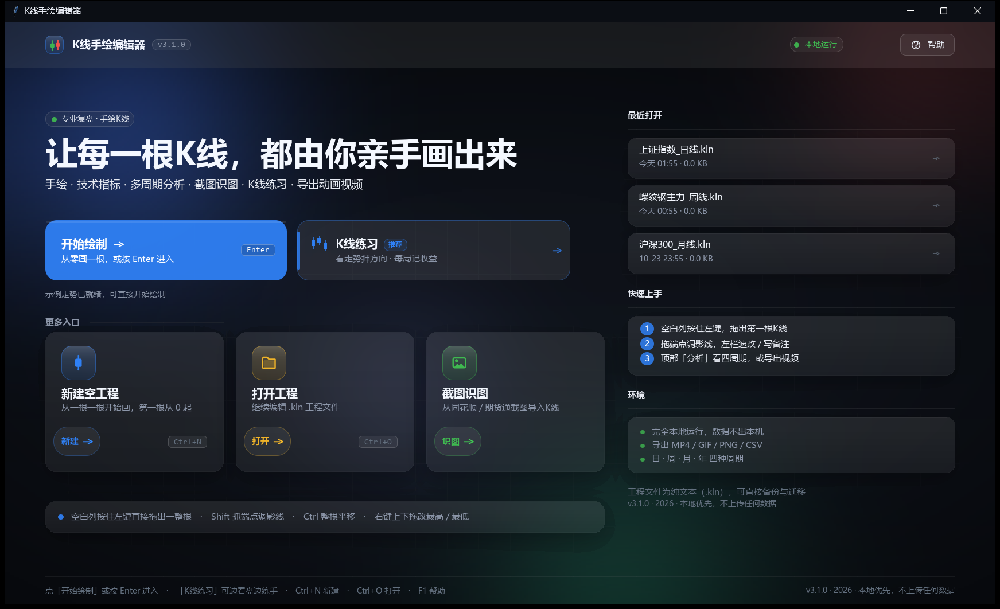
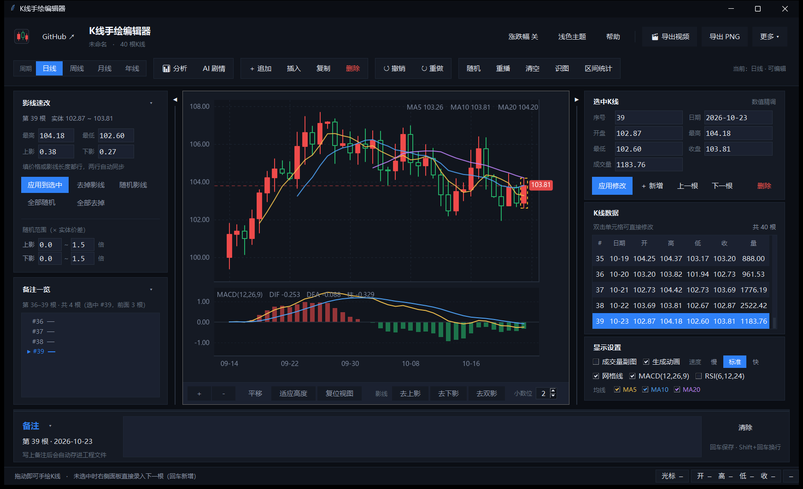
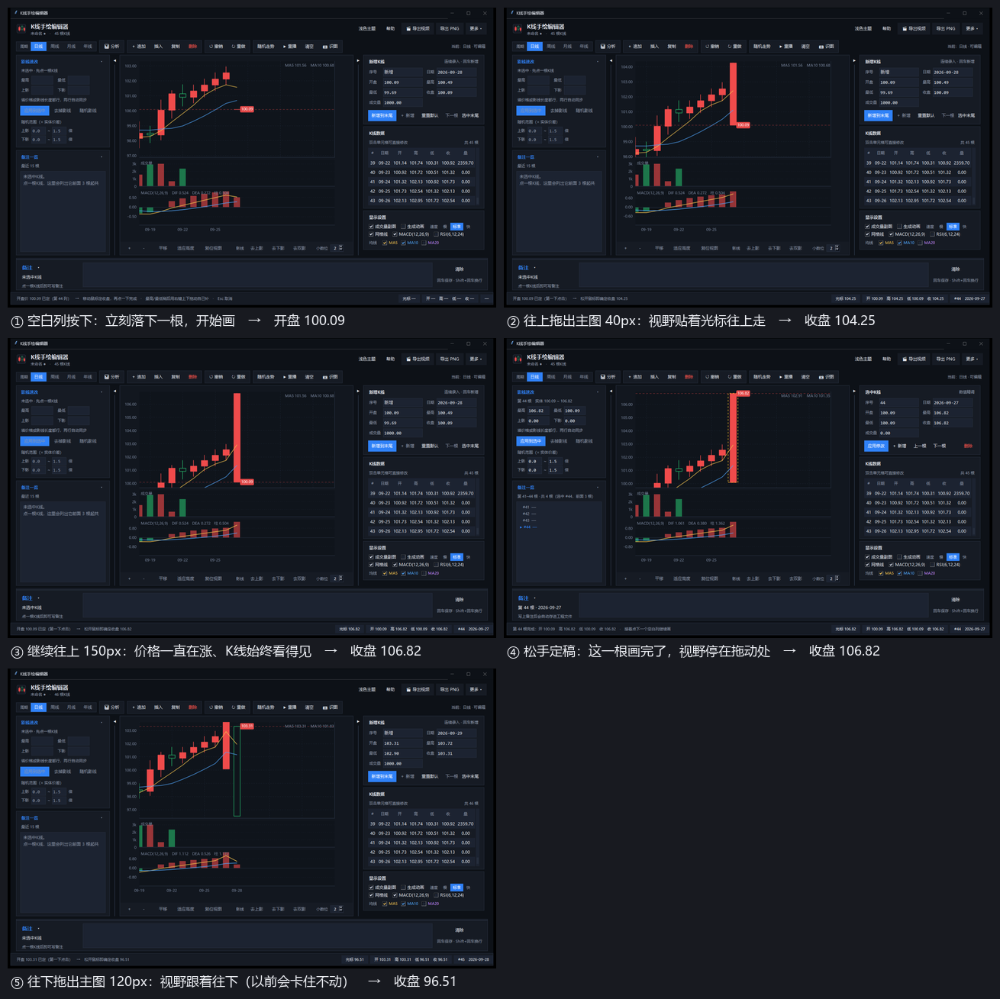
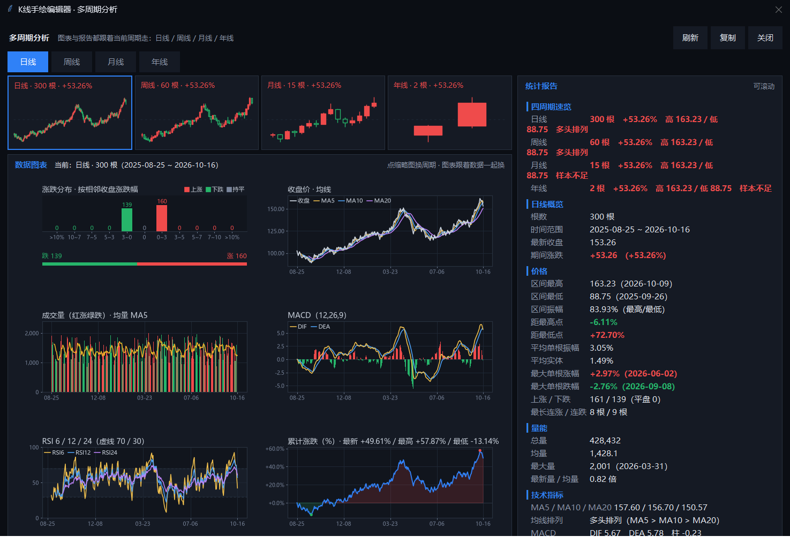
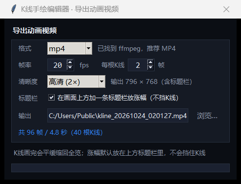

[简体中文](README.md) · **English**

# K-Line Painter

**Every candle, drawn by your own hand.**

No market feed, no code — drag on the canvas and a candle exists.
Then read it through MACD, RSI and moving averages, review it across timeframes,
import it from a screenshot, or export the whole thing as an animation.

---

## What it is

A **hand-drawn** charting workbench. Most charting software reads the market; this one does the
opposite — you draw the structure you have in mind (where it broke out, which candle was a fake
volume spike, what the top looked like) and immediately see how it behaves under MACD, RSI,
moving averages and multi-timeframe aggregation.

It fits a few kinds of work:

- Reviewing a trade by rebuilding the exact structure you saw, instead of screenshotting a live chart
- Making notes, teaching material, or article images — you need clean PNGs and videos
- Building hand-labelled samples or patterns before writing a quant rule, with exact control over every OHLC value
- Simply wanting a good-looking candlestick chart

**Fully offline.** No network, no telemetry, no account.

## Core features

| | Feature | Detail |
|---|---|---|
| ✏️ | **Drag to draw** | Press the left button on empty space and drag out a whole candle; the view follows your cursor past the edge so you can draw as far or as high as you want |
| 🎯 | **Four-way refinement** | `Shift` grabs an endpoint to adjust a wick, `Ctrl` moves the whole candle, right-drag sets high/low, `Alt` snaps to the nearest price tick |
| 📅 | **Daily / weekly / monthly / yearly** | Daily bars are the source of truth; the other timeframes are aggregated views that update themselves; weekly/monthly/yearly charts can be cleared directly |
| 🚦 | **Price-move limit** | The top-bar **涨跌幅** key cycles off / 10% / 20%. Dragging or typing **stops at the limit**; a Windows-style toast slides in from the right at the bottom-right: **取消涨跌幅限制** releases it and applies the original value; **保持限制** keeps the clamped price. Weekly/monthly/yearly allow *level × trading days* (5 per week); **highs and lows are clamped too**, so wicks cannot be dragged past the limit |
| 🎮 | **Candle practice** | The second primary action on the cover opens a trading drill inside the editor: a random series reveals 40 bars, `Space`/`→` reveals the next, `↑` goes long, `↓` goes short, `Esc` closes. ¥100k starting capital, **leverage 1–1000× with 5–100% position sizing**, forced liquidation on margin call; every run is scored into a local leaderboard (runs / average / best / worst) |
| 📐 | **Range statistics** | The button next to **识图**: click the start candle, click the end candle, get a report – change over the range, high/low with dates, amplitude, max drawdown, up/down/flat counts, longest streaks, per-candle moves, average body and wicks, total and average volume |
| ✂️ | **Remove all wicks** | The fifth button in the wick panel collapses every wick into the body across the whole chart, as **one single undo step** |
| 📊 | **Indicators** | MACD (12,26,9), RSI (6,12,24), MA5/10/20, volume with its average — recomputed live |
| 🔍 | **Analysis window** | `Ctrl+E` opens six charts (return distribution, close + MAs, volume, MACD, RSI, cumulative return) plus a four-timeframe statistical report, one click to copy |
| 🖼️ | **Import from screenshot** | Detect candles from a chart screenshot — **a visible price axis is read automatically and aligned** — or `Ctrl+V` straight from the clipboard |
| 🎬 | **Export animation** | Frame-by-frame MP4 / GIF with adjustable fps, frames per candle and resolution, cumulative return labelled on the right; the Y axis recentres itself while playing |
| 💬 | **Note per candle** | Multi-line note on any candle, marked with a diamond on the chart, saved in the project file and exported to CSV |
| ↩️ | **Full undo stack** | `Ctrl+Z` / `Ctrl+Y` for everything, including screenshot imports and batch wick edits |
| 🌗 | **Dark and light themes** | Dark by default; HiDPI aware (125% / 150% / 4K) |

## Screenshots

Main window · wick editor and note list on the left, price chart + MACD in the middle, selection and data table on the right

Drawing one candle · press on empty space to plant the open, drag up and the price follows the cursor all the way from 100.09 to 106.82

Analysis window (Ctrl+E) · four timeframe thumbnails, six charts and a statistical report — click a thumbnail and everything is recomputed for that timeframe

Export dialog · format, fps, frames per candle and resolution, with a live preview of frame count and output size

## Quick start

**Download the installer**

1. Get `KLinePainter-v3.1.0-Setup-win64.exe` from [Releases](https://github.com/nainai520/kline-editor/releases)
2. Run it — installs to `%LOCALAPPDATA%\Programs\K线手绘编辑器` by default (**no admin rights**, any drive you like)
3. Desktop / Start-menu shortcuts are optional; the app uninstalls cleanly from Windows settings

> If SmartScreen blocks the first launch: **More info → Run anyway**.

**Requirements**: Windows 10 / 11 x64, no Python, no network. The installer ships **no source code** and its payload is encrypted.
Exporting MP4 additionally needs `ffmpeg` on PATH; without it the app falls back to GIF.

## Keyboard shortcuts

| Shortcut | Action |
|---|---|
| `Ctrl+N` / `Ctrl+O` / `Ctrl+S` | New / open / save project (`.kln`) |
| `Ctrl+Z` / `Ctrl+Y` | Undo / redo |
| `Ctrl+D` / `Delete` | Duplicate / delete selection |
| `←` `→` | Move selection |
| `+` `-` / `0` | Zoom / reset view |
| `↑` `↓` | Shift the candle (`Shift+↑/↓` moves only the close) |
| `Ctrl+↑` `Ctrl+↓` `Ctrl+W` | Remove upper / lower / both wicks |
| `Ctrl+E` | Multi-timeframe analysis |
| `Ctrl+R` | Replay the animation |
| `Ctrl+V` | Paste a screenshot and detect candles |
| `Insert` | Append a candle from panel values |
| `F1` | Help |

## Data model

One rule runs through the whole program:

> **Daily bars are the data. Weekly / monthly / yearly are only ways of looking at it.**

- `self._daily` holds the real daily series; switching timeframe never touches it
- Weekly/monthly/yearly are aggregated on the fly (open = first open, close = last close, high/low = extremes, volume = sum)
- Editing an aggregated candle is written **back into the daily series** and re-aggregated, so nothing is lost when you switch back
- Saving a project or exporting CSV always writes the daily data
- Drawing a candle on the yearly chart **cascades down** to monthly → weekly → daily, with parent open/close exactly reconstructed from children

Project files (`.kln`) are plain-text JSON — readable, diffable, easy to back up.

## Implementation

| Layer | Choice | Note |
|---|---|---|
| UI | Tkinter | A design-token layer owns colour, spacing and radius; widgets come from factories; both themes share one palette |
| Charts | matplotlib (TkAgg) | `LineCollection` / `PolyCollection` batch drawing keeps large series interactive |
| Bitmap | Pillow + numpy | The splash uses a layered window (`UpdateLayeredWindow`) for real blur and rounded shadows |
| Video | ffmpeg pipe / Pillow | Frames are baked and piped as `yuv420p` — what you export is what you watched |
| Packaging | PyInstaller + custom installer | Besides the single-file exe there is a setup: onedir payload, AES-256-GCM encrypted, no %TEMP% unpacking and a clean uninstall |

Roughly 11k lines, developed alongside **17 assertion-based test files** covering data round-trips,
pixel-level colour checks, export dimensions, and an end-to-end check of the packaged exe.

## Privacy

- Runs entirely offline — the app makes no network requests
- No telemetry, no account, no cloud sync
- Projects, images and videos stay on your own disk

## Limitations

- Windows only (uses layered windows and DPI APIs)
- Screenshot detection works best on clean, dark, unobstructed charts; unrecognised volume is filled with 0
- The narrative engine needs your own GGUF model file and is off by default

## Changelog

See [CHANGELOG.md](CHANGELOG.md).

## Copyright and terms of use

© 2026 nainai520. All rights reserved.

- ✅ Free to download, use and share — notes, teaching material and articles built on it are welcome
- ✅ Keep the author's credit when you redistribute or quote it
- ❌ **No commercial use** — you may not sell it, bundle it into a paid product or service, or use it for commercial promotion
- Contact the author for a commercial license

If this tool is useful to you, a star is the best thank-you ⭐

